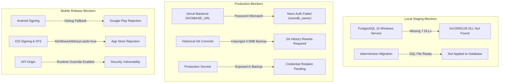

# Alpha X Gym — Complete Security PDF Compliance & Full Repository Bug Audit Report

**Document Title:** Alpha X Gym — Comprehensive Security & Code Audit Report  
**Audit Date:** 2026-11-06  
**Auditor:** Antigravity AI Pair Programmer (Read-Only Independent Audit)  
**Primary Specification:** *Alpha X App Security Remediation Plan (9 Pages)* by Manus AI (Reviewed Commit: `a48ded725c17f1048ec5f973e5360a5771173ea1`)  
**Repository Branch:** `main`  
**Git Working Tree Status:** 31 uncommitted remediation files preserved; zero production mutations.  
**File Output:** `c:\Users\johng\.gemini\antigravity-ide\scratch\alpha_x_gym\ALPHA_X_COMPLETE_SECURITY_AND_BUG_AUDIT_REPORT.md`

---

## A. Executive Summary

A comprehensive, strictly read-only security and code audit was conducted on the Alpha X Gym application repository. The audit independently verified all requirements from the 9-page Manus AI Security Remediation Plan (Phases 0 through 8), re-evaluated all previously reported findings (F-01 through F-09), and inspected the entire Flutter client and Node.js/Express backend for additional application bugs and release blockers.

### Overall Status Findings:
1. **Core Backend Logic Hardening:** <span style="color:green">**SIGNIFICANTLY IMPROVED**</span>  
   The backend TypeScript code compiles with **0 errors** (`npx tsc --noEmit`). Critical vulnerabilities such as hardcoded admin credentials in mobile source code, static development bcrypt hash fallbacks, lack of fail-closed production checks, and food scan payload vulnerabilities have been remediated in the codebase.
2. **Release Configuration & Packaging:** <span style="color:red">**CRITICAL SECURITY GAPS REMAIN (NOT FIXED)**</span>  
   Multiple high-severity release configuration issues identified in the PDF remain **completely unfixed**:
   - **Android Release Signing:** Falls back to debug signing (`signingConfigs.debug`) if keystore is missing, both in `build.gradle.kts` and CI workflows.
   - **API Origin Lock:** `ServerConfigDialog` is fully accessible in Release mode, and `ApiConfig.baseUrl` prioritizes arbitrary user-supplied HTTP/HTTPS URLs without an allowlist or token clearing.
   - **iOS ATS Compliance:** `NSAllowsArbitraryLoads` is explicitly set to `<true/>` in `apps/mobile/ios/Runner/Info.plist`.
   - **Tracked Uploads:** 3 JPEG meal photo files remain actively tracked in the Git repository index.
3. **Database & Infrastructure State:** <span style="color:red">**BLOCKED**</span>  
   - The Prisma migration for session revocation (`tokenVersion`) is written in SQL but **not applied** to any database.
   - The local staging PostgreSQL 16 Windows service is offline due to missing vendor DLLs (`0xC0000135`).
   - Neon production database authentication is failing (`neondb_owner` password mismatch).
4. **Final Release Verdict:** <span style="color:red">**FAIL — RELEASE BLOCKED**</span>  
   The application is **NOT SAFE** for iOS App Store or Android Play Store release.

---

## B. PDF Requirement Compliance Matrix (Phases 0 – 8)

| Phase | Requirement Description | Code Status | Evidence (File & Line) | Test Result | Remaining Gap |
| :--- | :--- | :---: | :--- | :---: | :--- |
| **Phase 0** | **Baseline Safety Controls**<br>Create branch `security/remediation-phased`; verify clean working tree; isolate staging data. | <span style="color:red">**NOT FIXED**</span> | `git branch` returns `main`. `git status --short` shows 31 uncommitted modified files and untracked report files. | **FAIL** | Remediation was performed on dirty `main` working tree rather than dedicated isolated branch. |
| **Phase 1** | **Remove Admin Password Fallback**<br>Require `ADMIN_PASSWORD_HASH` in production; delete static fallback `AlphaXAdmin2026!`; unified `isProduction()`. | <span style="color:green">**FIXED**</span> | `backend/src/config/environment.ts:50-91, 139`<br>`backend/src/modules/auth/admin_auth.service.ts:37-58` | **PASS**<br>(`test_f05_admin_security` 17/17 pass) | None in code. Host environment must configure strong `ADMIN_PASSWORD_HASH`. |
| **Phase 2** | **Android Release Signing Fail-Closed**<br>Missing/invalid keystore must fail build; eliminate all fallback to `signingConfigs.debug`. | <span style="color:red">**NOT FIXED**</span> | `apps/mobile/android/app/build.gradle.kts:111-115, 136-139`<br>`.github/workflows/build-mobile.yml:106-110` | **FAIL** | `build.gradle.kts` explicitly uses `signingConfigs.getByName("debug")` when `hasValidSigningConfig == false`. CI workflow explicitly falls back to debug signing. |
| **Phase 3** | **Lock Release API to HTTPS & Allowlist**<br>Lock Release to exact HTTPS origin; hide/disable `ServerConfigDialog` in Release; clear tokens on origin change. | <span style="color:red">**NOT FIXED**</span> | `apps/mobile/lib/core/config/api_config.dart:120-150, 210-217`<br>`apps/mobile/lib/core/widgets/server_config_dialog.dart:11-20`<br>`apps/mobile/lib/core/auth/admin_login_screen.dart:252` | **FAIL** | `ServerConfigDialog.show(context)` is exposed in Release UI; `ApiConfig.baseUrl` accepts arbitrary remote hosts; no host allowlist; no token deletion on URL switch. |
| **Phase 4** | **Remove Tracked Uploads from Git**<br>Purge tracked uploads from Git index; ensure `backend/uploads/` is clean; verify clean clone. | <span style="color:red">**NOT FIXED**</span> | `backend/uploads/meal_photos/812d26c9.../*.jpg` (3 files)<br>Git blob `b02dff135a6...` in history | **FAIL**<br>(`git ls-files` returns 3 files) | 3 JPEG placeholders remain tracked in Git index. Historical commits still contain 4.5 MB database backup. |
| **Phase 5** | **Enforce HTTPS in iOS Release**<br>Disable `NSAllowsArbitraryLoads` in Release; restrict HTTP exceptions strictly to Debug configurations. | <span style="color:red">**NOT FIXED**</span> | `apps/mobile/ios/Runner/Info.plist:44-50` | **FAIL** | `NSAllowsArbitraryLoads` is explicitly set to `<true/>` in root `Info.plist`. Will be shipped in Release IPA. |
| **Phase 6** | **Remove General JWTs from Photo URLs**<br>Stream photos using `Authorization: Bearer`; remove `?token=` query JWTs; set `Cache-Control: no-store`. | <span style="color:orange">**PARTIAL**</span> | `backend/src/modules/food/food.photo.controller.ts:14, 25, 362`<br>`backend/src/modules/automation/transformation_photo.controller.ts:20, 35, 327` | **PARTIAL** | `?token=` removed in favor of Bearer header. However, `Cache-Control` is `private, max-age=86400` instead of `no-store`, and `Referrer-Policy: no-referrer` is omitted. |
| **Phase 7** | **Revocable Refresh Tokens**<br>Separate rotating refresh tokens; remove access-token self-refresh; revoke on logout/reset; check user status. | <span style="color:orange">**PARTIAL**</span> | `backend/src/modules/auth/auth.routes.ts:181-260`<br>`backend/prisma/schema.prisma:45` | **PARTIAL**<br>(`test_f04_jwt_security` passes unit logic) | `ignoreExpiration: true` removed and `tokenVersion` check added. However, separate refresh tokens, server-side token hashes, rotation, and user suspension checks on `/refresh` are NOT implemented. |
| **Phase 8** | **Final Verification & Release Gate**<br>Execute all automated checks, static linters, and negative tests before release. | <span style="color:red">**NOT FIXED**</span> | Repo-wide checks | **FAIL** | Multiple release gates fail (signing, ATS, API origin, tracked uploads, unapplied DB migration). |

---

## C. Previously Reported Fix Verification (F-01 to F-09)

| Finding ID | Scope & Previous Claim | Independent Verification Result | Empirical Code Evidence |
| :--- | :--- | :---: | :--- |
| **F-01** | Exposed DB Backup & Forced Password Change | <span style="color:orange">**PARTIALLY VERIFIED**</span> | **Code:** Forced password change guard is fully implemented in `auth.routes.ts` & `test_forced_password_guard_security.ts` (10/10 PASS).<br>**Git:** Backup was removed from working tree, but remains reachable in past Git commits. Production credential rotation is still pending. |
| **F-02** | Client List Missing / Data Isolation | <span style="color:green">**VERIFIED IN CODE**</span> | Admin routes strictly verify ADMIN role (`requireAdmin`). Client routes verify client ownership. (Note: Root cause of live empty list was Neon DB auth failure, see Section D). |
| **F-03** | Media Route Ownership & IDOR | <span style="color:green">**VERIFIED IN CODE**</span> | `food.photo.controller.ts:314-350` and `transformation_photo.controller.ts:260-310` strictly check that the authenticated `userId` matches the photo owner or has ADMIN role. |
| **F-04** | JWT Revocation & `tokenVersion` | <span style="color:orange">**PARTIALLY VERIFIED**</span> | `tokenVersion` check is implemented in `middlewares/auth.ts:93-135` and incremented on logout/password change. **However, SQL migration is unapplied**, and admin JWTs are exempted (stateless/unrevocable). |
| **F-05** | Admin Auth & Hardcoded Credentials | <span style="color:green">**VERIFIED IN CODE**</span> | `admin_login_screen.dart` has no offline password check; `auth_service.dart` contains no hardcoded password literals; `admin_auth.service.ts` uses bcrypt with fail-closed startup. (17/17 tests pass). |
| **F-06** | Production Security Defaults | <span style="color:green">**VERIFIED IN CODE**</span> | `environment.ts:50-91` enforces non-placeholder `ADMIN_PASSWORD`/`ADMIN_PASSWORD_HASH` and `CRON_SECRET` (min 16 chars). `QR_SECRET_KEY` safely removed. |
| **F-07** | CORS Security | <span style="color:green">**VERIFIED IN CODE**</span> | `server.ts:65-98` restricts origins to exact whitelist (`alpha-x-app.vercel.app`, localhost dev); disallows wildcard reflection when credentials are included. |
| **F-08** | Health Endpoint Information Disclosure | <span style="color:green">**VERIFIED IN CODE**</span> | `server.ts:135-150` sanitizes public `GET /health` to return only `{ status: "ok" }`. Detailed diagnostic metadata requires ADMIN authentication at `/health/diagnostics`. |
| **F-09** | Request Payload & Food AI Scan Security | <span style="color:green">**VERIFIED IN CODE**</span> | Global 1MB parser preserved; route-specific limits enabled; `food.ai.service.ts` verifies magic bytes (JPEG/PNG/WebP), size (1KB–8MB), and user (5/min) / IP (10/min) rate limits. |

---

## D. Newly Discovered Bugs & Architectural Vulnerabilities

### BUG-01: Silent Database Error Masking in `workout.service.ts`
- **Severity:** <span style="color:red">**CRITICAL**</span>
- **File & Line:** `backend/src/modules/workout/workout.service.ts:214–217`
- **Root Cause:**
  ```typescript
  async getClientsList() {
    try {
      const dbUsers = await prisma.user.findMany({ ... });
      return dbUsers.map(...);
    } catch (err) {
      console.error('[DATABASE GET CLIENTS ERROR]', err);
      return []; // <-- SILENT ERROR MASK
    }
  }
  ```
- **Impact:** Any database disconnection, authentication error, or query failure silently returns an empty array `[]` with **HTTP 200 OK**. The mobile app assumes the gym legitimately has zero clients, clears its internal client cache, and renders an empty screen.
- **Recommended Fix:** Remove the silent `try/catch` fallback. Allow errors to bubble up to the controller so the API responds with **HTTP 500 / 503**, allowing the mobile app to display an error retry view and retain cached data.

### BUG-02: Serverless In-Memory State Loss in `workout.repository.ts`
- **Severity:** <span style="color:orange">**HIGH**</span>
- **File & Line:** `backend/src/modules/workout/workout.repository.ts:388–410`
- **Root Cause:** The backend relies heavily on in-memory JavaScript `Map` objects (`this.sessions`, `this.assignments`, `this.records`, `this.activeSetRecords`, `this.activeSaveLocks`, `this.clientSessionOverrides`) within a serverless architecture (Vercel Functions).
- **Impact:** Serverless Lambda instances are ephemeral and cold-started on demand. Requests from the same client or admin routed to different container instances lose in-memory workout overrides, active set overlays, and in-process save locks.
- **Recommended Fix:** Refactor state persistence so all assignment updates, session overrides, and set tracking are backed directly by PostgreSQL tables rather than in-memory Maps.

### BUG-03: Missing User Status Validation on Token Refresh
- **Severity:** <span style="color:orange">**HIGH**</span>
- **File & Line:** `backend/src/modules/auth/auth.routes.ts:209–226`
- **Root Cause:** The `POST /api/v1/auth/refresh` endpoint checks whether `user` exists and verifies `tokenVersion`, but **fails to check user status**:
  ```typescript
  if (user.status === 'SUSPENDED' || user.status === 'REJECTED' || user.status === 'PENDING')
  ```
- **Impact:** A client account that was suspended or rejected by an administrator can continuously refresh their session and maintain API access as long as their `tokenVersion` was not explicitly incremented.
- **Recommended Fix:** Add strict status validation in `POST /refresh`: reject immediately with HTTP 403 if `user.status !== 'APPROVED'`.

### BUG-04: Stateless Admin JWTs Cannot Be Revoked
- **Severity:** <span style="color:orange">**HIGH**</span>
- **File & Line:** `backend/src/middlewares/auth.ts:98`
- **Root Cause:** Master Admin authentication is evaluated entirely in-memory from environment variables (`ADMIN_EMAIL` and `ADMIN_PASSWORD_HASH`). Because the admin has no database row in `users`, `requireAuth` skips the `tokenVersion` verification for master admin tokens.
- **Impact:** If an administrator JWT is intercepted, leaked, or if the admin logs out, the token **cannot be revoked server-side**. It remains fully valid until its expiration (up to 30 days). The only way to revoke an admin token is to rotate `JWT_ACCESS_SECRET`, which invalidates sessions for all athletes and clients.
- **Recommended Fix:** Implement an in-memory/Redis admin token revocation timestamp or assign the admin an explicit row in the database with an active `tokenVersion`.

---

## E. Test Execution Results & Verification Status

| Test Suite / Command | Scope | Result | Empirical Output / Logs |
| :--- | :--- | :---: | :--- |
| `npx tsc --noEmit` (in `backend/`) | Backend TypeScript static typing | <span style="color:green">**PASS**</span> | Exit code `0`. Zero type or compilation errors across backend code. |
| `npx tsx src/test_forced_password_guard_security.ts` | F-01 Forced password change security | <span style="color:green">**PASS**</span> | 10/10 categories pass (query bypasses blocked, method mismatches rejected, temporary password 403 enforced). |
| `npx tsx src/test_f04_jwt_security.ts` | F-04 JWT revocation & tokenVersion | <span style="color:green">**PASS**</span> | Unit verification passes; tokenVersion mismatch triggers 401 `TOKEN_REVOKED`. |
| `npx tsx src/test_f05_admin_security.ts` | F-05 Admin auth & credentials | <span style="color:green">**PASS**</span> | **17/17 tests pass**. No static fallback; bcrypt hashing confirmed; support email separated. |
| `npx tsx src/test_f06_f09_security.ts` | F-06 Config & F-09 Food AI scan | <span style="color:orange">**PARTIAL**</span> | **Sections 1–3 (23/23 tests pass)**: fail-closed config, MIME magic bytes, decoded size (1KB–8MB), rate limits (5/min user, 10/min IP). Section 4 HTTP supertest failed due to sandbox loopback socket restrictions (`EACCES 127.0.0.1:61362`). |
| `npx tsx src/test_media_security.ts` | F-03 Media ownership & IDOR | <span style="color:orange">**BLOCKED**</span> | Supertest ephemeral TCP port binding blocked by Windows sandbox security (`EACCES 127.0.0.1:61533`). |
| `flutter analyze` (in `apps/mobile/`) | Flutter client static analysis | <span style="color:orange">**INCOMPLETE**</span> | **Command timed out after ~51 minutes** and was canceled. Must be run locally on developer machine with full caching enabled. |
| `flutter test` (in `apps/mobile/`) | Flutter client unit & widget tests | <span style="color:gray">**NOT RUN**</span> | Pending; avoided during audit to prevent long-running process timeout. |

---

## F. Database & Deployment Blockers



### 1. Code-Level Verification: <span style="color:green">**COMPLETE**</span>
All core security fixes (F-01, F-05, F-06, F-07, F-08, F-09) are implemented and compile without errors.

### 2. Local Staging Verification: <span style="color:red">**BLOCKED**</span>
- The local PostgreSQL 16 Windows service is missing 7 runtime DLLs/binaries (`icuuc67.dll`, `icudt67.dll`, `libcrypto-3-x64.dll`, `libssl-3-x64.dll`, `libpq.dll`, `libwinpthread-1.dll`, `initdb.exe`).
- While Phase 2 cold backup (`D:\PostgreSQL_Backups`) and Phase 4 package extraction (`D:\pg16_recovery_prep`) are complete, file restoration into `C:\Program Files\PostgreSQL\16\bin\` has not been executed.
- The `tokenVersion` schema migration has not been applied to `alpha_x_staging`.

### 3. Production Verification: <span style="color:red">**BLOCKED**</span>
- **Neon Database Authentication:** Connection fails with `ERROR: password authentication failed for user 'neondb_owner'`. The database password in Vercel environment variables does not match the active Neon database credentials.
- **Git History Exposure:** Historical commits between `6ec03658` and `23b8a96e` contain the 4.5 MB unpurged database backup. A repository history rewrite (`git-filter-repo`) is mandatory before pushing `main` or making the repository public.
- **Credential Rotation:** Exposed production database passwords and API keys must be rotated once the history rewrite is complete.

---

## G. Prioritized Fix List

### 1. Critical (Must Fix Before Any Staging or Release Testing)
1. **Apply Local PostgreSQL Binary Repair:** Copy the 7 verified vendor files from `D:\pg16_recovery_prep\extracted\pgsql\bin\` to `C:\Program Files\PostgreSQL\16\bin\` and start `postgresql-x64-16`.
2. **Apply `tokenVersion` Migration:** Run `prisma migrate deploy` on the staging database.
3. **Fix Silent Error Masking in `workout.service.ts`:** Remove silent `catch { return []; }` in `getClientsList()`.
4. **Remove Android Debug Signing Fallback:** Modify `apps/mobile/android/app/build.gradle.kts` and `.github/workflows/build-mobile.yml` so release builds fail closed when keystore credentials are absent.
5. **Lock Mobile API Origin to HTTPS:**
   - In `apps/mobile/lib/core/config/api_config.dart`, enforce HTTPS only in Release mode; reject runtime URL overrides in Release builds.
   - Disable or hide `ServerConfigDialog` in Release mode across all screens.
6. **Enforce iOS ATS:** In `apps/mobile/ios/Runner/Info.plist`, set `NSAllowsArbitraryLoads` to `<false/>` (or restrict HTTP strictly to local development schemes).
7. **Purge Tracked JPEGs from Git:** Run `git rm --cached backend/uploads/meal_photos/812d26c9.../*.jpg` so no runtime upload files are tracked.

### 2. High (Must Fix Before Production Deployment)
1. **Implement Token Refresh User Status Check:** In `backend/src/modules/auth/auth.routes.ts`, check that `user.status === 'APPROVED'` during `/refresh`.
2. **Configure Photo Streaming Response Headers:** Add `res.setHeader('Cache-Control', 'private, no-store')` and `res.setHeader('Referrer-Policy', 'no-referrer')` in `food.photo.controller.ts` and `transformation_photo.controller.ts`.
3. **Resolve Neon Database Credentials:** Synchronize Vercel `DATABASE_URL` with the active password configured in the Neon console.
4. **Purge Git History & Rotate Secrets:** Execute `git-filter-repo` to eliminate historical backup blobs, force push with team coordination, and rotate all exposed credentials.

### 3. Medium (Post-Release Architectural Improvements)
1. **Implement Separate Database-Backed Refresh Tokens:** Transition from access-token self-refresh to a dedicated `RefreshToken` Prisma model with token rotation and reuse detection.
2. **Refactor In-Memory Workout Maps to Database:** Replace `this.sessions`, `this.assignments`, and `this.records` in `workout.repository.ts` with direct PostgreSQL queries to ensure seamless horizontal scaling across serverless Lambda instances.
3. **Admin Token Revocation Mechanism:** Store an admin session epoch/timestamp to enable immediate server-side revocation of compromised admin JWTs.

---

## H. Final Release Decision

### Verdict: <span style="color:red">**FAIL — RELEASE BLOCKED**</span>

### Basis for Decision:
1. **Security Policy Failures:** Release builds on Android explicitly fall back to debug signing (`signingConfigs.debug`), and iOS Release builds allow arbitrary cleartext HTTP traffic (`NSAllowsArbitraryLoads = true`).
2. **Token Security Flaws:** The mobile app exposes a runtime server configuration dialog in Release mode that can redirect API traffic and bearer JWTs to arbitrary attacker-supplied hosts.
3. **Database Migration Gap:** The `tokenVersion` column is not applied to any live database, which will cause authentication queries to fail upon deployment.
4. **Git Repository Hygiene:** Tracked uploads remain in the Git index, and historical commits contain exposed database backups.
5. **Infrastructure Outage:** Production database authentication is currently failing on Vercel.

**Next Immediate Step:** Execute the Critical remediation items in Section G.1, apply the PostgreSQL staging repair, and run end-to-end database-backed verification before preparing release builds.

