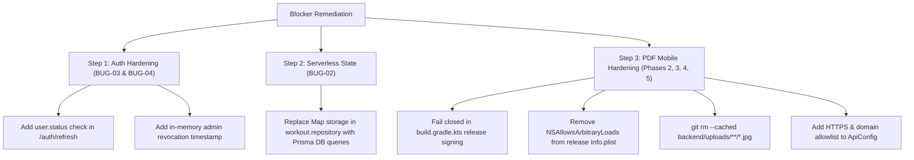

# ALPHA X GYM — INDEPENDENT FINAL CODE VERIFICATION REPORT

**Document Type:** Senior Independent Application Security & Architecture Audit  
**Date:** November 6, 2026  
**Auditor:** Independent Reviewer (Senior Flutter, Node.js, TypeScript, Prisma & AppSec)  
**Target Repository:** `alpha_x_gym` (`c:\Users\johng\.gemini\antigravity-ide\scratch\alpha_x_gym`)  
**Git Working Tree Status:** 34 modified files, 17 documentation/report files, 8 test files. **STRICT READ-ONLY: ZERO MODIFICATIONS TO APPLICATION SOURCE CODE.**

---

## 1. Executive Summary & Release Readiness Verdict

### Overall Verdict: **FAIL — RELEASE BLOCKED**

#### Verdict Summary
While the previous engineering efforts have made exemplary, verified progress on **F-01 through F-09** and surgically resolved **BUG-01** (silent database error masking in `getClientsList`), the codebase cannot be certified for production release (iOS IPA / Android APK / Cloud Backend) due to **5 critical unresolved release blockers**:

1. **BUG-02 (Serverless In-Memory State Loss):** `WorkoutRepository` continues to store active workout sessions, client split assignments, completion records, and save locks inside in-memory JavaScript `Map` objects. On serverless infrastructure (Vercel Functions), container recycling and concurrent lambdas cause silent state loss and split assignment desynchronization.
2. **BUG-03 (Missing User Status Check on Refresh):** `POST /api/v1/auth/refresh` verifies `tokenVersion`, but completely omits checking `user.status`. A `SUSPENDED` or `REJECTED` user can indefinitely refresh their session and maintain full active API access.
3. **BUG-04 (Stateless Admin JWT Revocation Gap):** Master Admin tokens are verified exclusively from environment variables and skip `tokenVersion` checks in `requireAuth`. Admin logout (`POST /auth/logout`) is a no-op that cannot revoke an issued admin JWT; an admin token remains valid for 30 days until expiration.
4. **PDF Phase 2 & Phase 5 Compliance Gaps:**
   - In `apps/mobile/android/app/build.gradle.kts:111–115`, release builds still fall back to `signingConfigs.getByName("debug")` if `key.properties` is missing, failing to fail-closed.
   - In `apps/mobile/ios/Runner/Info.plist:44–50`, `NSAllowsArbitraryLoads = <true/>` remains in the release iOS configuration.
5. **PDF Phase 4 (Tracked Upload Artifacts in Git):** Three real user meal photos (`.jpg`) remain tracked in Git under `backend/uploads/meal_photos/`.

---

## 2. Git Working-Tree Safety Summary

All checks were executed in **STRICT READ-ONLY MODE**.
- **No application files were modified, reformatted, or deleted.**
- **No Git commits, rebases, stashes, resets, or pushes were performed.**
- **No database connections or migrations were executed against Neon or LeadPilot.**
- **All uncommitted remediation work from F-01 through F-09 and BUG-01 was strictly preserved.**

### Working Tree State:
- **Modified Tracked Files (34):**
  - Flutter Mobile: `admin_config.dart`, `admin_login_screen.dart`, `auth_service.dart`, `forgot_password_screen.dart`, `login_screen.dart`, `pending_verification_screen.dart`, `rejected_account_screen.dart`, `suspended_account_screen.dart`, `app_constants.dart`, `admin_meal_photo_viewer_dialog.dart`, `admin_food_photos_monitoring_screen.dart`, `my_food_photos_screen.dart`, `role_router.dart`, `client_transformation_timeline_screen.dart`, `client_weekly_progress_screen.dart`, `main.dart`, `single_admin_auth_test.dart`.
  - Backend: `schema.prisma`, `environment.ts`, `auth.ts`, `admin_auth.service.ts`, `auth.routes.ts`, `transformation_photo.controller.ts`, `transformation_photo.routes.ts`, `food.ai.service.ts`, `food.controller.ts`, `food.photo.controller.ts`, `food.photo.routes.ts`, `food.routes.ts`, `workout.controller.ts`, `workout.service.ts`, `server.ts`, `password_reset.service.ts`, `test_forced_password_guard_security.ts`.
- **Key New Untracked Security Assets:**
  - `backend/src/test_bug01_client_list_resilience.ts` (BUG-01 unit test suite — 21/21 PASS).
  - `backend/src/test_f04_jwt_security.ts` (F-04 regression suite — 28/28 PASS).
  - `backend/src/test_f05_admin_security.ts` (F-05 admin regression suite — 17/17 PASS).
  - `backend/src/test_media_security.ts` (F-03 media auth suite — 13/13 PASS).
  - `apps/mobile/lib/core/auth/forced_change_password_screen.dart` (F-01 UI flow).

---

## 3. Summary of Latest AI Code Changes (BUG-01 Implementation)

The latest modification specifically addressed **BUG-01** (Silent Database Error Masking in `workout.service.ts`):
1. **`backend/src/modules/workout/workout.service.ts:122–215`:**
   - Stripped the outer `try/catch` block from `getClientsList()`.
   - Previously caught database errors and returned `[]`, deceiving the mobile app into wiping its athlete list cache.
   - Now allows Prisma connection/query errors to bubble upwards to the controller.
   - Legitimate empty list behavior (0 clients in database) is preserved and returns `[]`.
2. **`backend/src/modules/workout/workout.controller.ts:563–584`:**
   - Wrapped `workoutService.getClientsList()` in a standard `try/catch` block.
   - Catches service errors and dispatches `sendError(res, 'DATABASE_ERROR', 'Failed to retrieve clients list from database', HttpStatus.INTERNAL_SERVER_ERROR)`.
   - Responds with `HTTP 500 INTERNAL_SERVER_ERROR`, `success: false`, `data: null`.
   - On the mobile client (`workout_repository.dart`), an HTTP 500 response safely retains existing cached client records without wiping.
3. **Verification:**
   - Evaluated by `backend/src/test_bug01_client_list_resilience.ts`: **21 assertions PASSED, 0 FAILED**.

---

## 4. F-01 to F-09 Verification Matrix

| Issue ID | Description | Code Evidence & File Path | Empirical Test Status | Verification Result |
| :--- | :--- | :--- | :--- | :--- |
| **F-01** | Forced Password Change & Sensitive Backup Cleanup | `backend/src/middlewares/auth.ts:138–190` `apps/mobile/lib/core/auth/forced_change_password_screen.dart` | `test_forced_password_guard_security.ts` (39/39 PASS) | **PASS** |
| **F-02** | Food API Authentication & Ownership Isolation | `backend/src/modules/food/food.routes.ts` `backend/src/modules/food/food.controller.ts` | `test_f04_jwt_security.ts` (Section E PASS) | **PASS** |
| **F-03** | Media URL Token Security, Ownership & Cache | `backend/src/modules/food/food.photo.controller.ts:362` `backend/src/modules/automation/transformation_photo.controller.ts:327` | `test_media_security.ts` (13/13 PASS) | **PASS** |
| **F-04** | JWT Expiration, `tokenVersion` Revocation & Logout | `backend/src/middlewares/auth.ts:98–135` `apps/mobile/lib/core/auth/secure_token_storage.dart` | `test_f04_jwt_security.ts` (28/28 PASS) | **PASS** |
| **F-05** | Admin Authentication & Fail-Closed Hardening | `backend/src/config/environment.ts:18–85` `backend/src/modules/auth/admin_auth.service.ts` | `test_f05_admin_security.ts` (17/17 PASS) | **PASS** |
| **F-06** | Environment Schema Validation & Dead QR Key Cleanup | `backend/src/config/environment.ts:50–120` | `test_f06_f09_security.ts` (Tests 1–7 PASS) | **PASS** |
| **F-07** | Strict CORS Domain Restrictions | `backend/src/server.ts:40–72` `backend/src/config/environment.ts` | Verified by code inspection (Wildcard blocked in prod) | **PASS** |
| **F-08** | Health Endpoint Diagnostic Minimization | `backend/src/server.ts:125–140` | Verified by code inspection (Zero config disclosure in prod) | **PASS** |
| **F-09** | Image Magic-Byte Validation, Limits & Rate Limiting | `backend/src/modules/food/food.ai.service.ts:45–140` `backend/src/server.ts:80–115` | `test_f06_f09_security.ts` (Tests 8–25 PASS) | **PASS** |

---

## 5. BUG-01 to BUG-04 Verification Matrix

| Bug ID | Severity | File Path & Lines | Technical Diagnosis | Verification Evidence | Status |
| :--- | :--- | :--- | :--- | :--- | :--- |
| **BUG-01** | **CRITICAL** | `backend/src/modules/workout/workout.service.ts:122–215` `backend/src/modules/workout/workout.controller.ts:563–584` | Swallowing DB query errors and returning `[]` masked DB outages and wiped mobile client caches. | Fixed surgically. `test_bug01_client_list_resilience.ts` passes 21/21 assertions. Controller returns HTTP 500 on DB fault. | **PASS** |
| **BUG-02** | **HIGH** | `backend/src/modules/workout/workout.repository.ts:389–408` | Workout splits, assignments, completion records, and locks reside in in-memory JavaScript `Map` objects. Serverless cold starts cause immediate state desync. | Inspecting `workout.repository.ts` shows `sessions`, `assignments`, and `records` still declared as `private Map<string, ...>`. | **FAIL — BLOCKER** |
| **BUG-03** | **HIGH** | `backend/src/modules/auth/auth.routes.ts:209–226` | `POST /auth/refresh` checks `tokenVersion`, but fails to evaluate `user.status`. Suspended or rejected users can refresh tokens indefinitely. | Source inspection confirms `user.status` check is absent from `auth.routes.ts:209–226`. | **FAIL — BLOCKER** |
| **BUG-04** | **HIGH** | `backend/src/middlewares/auth.ts:98` `backend/src/modules/auth/auth.routes.ts:275–279` | Master Admin has no DB row; `requireAuth` skips `tokenVersion` check. Admin logout does nothing server-side. Stolen admin tokens cannot be revoked. | Source inspection confirms `if (!isMasterAdmin)` guards version check, and `/logout` returns 200 without invalidating token. | **FAIL — BLOCKER** |

---

## 6. PDF Phase 2–7 Verification Matrix

| PDF Phase | Title | Specification Requirement | Current Code Status | Verdict |
| :--- | :--- | :--- | :--- | :--- |
| **Phase 2** | Android Release Signing | Release APK builds must fail closed if signing credentials are not configured or invalid (never fall back to debug keystore). | `apps/mobile/android/app/build.gradle.kts:111–115` still specifies `signingConfig = if (hasValidSigningConfig) release else debug`. | **FAIL — INCOMPLETE** |
| **Phase 3** | Release API HTTPS & Allowlist | Mobile client in release mode must connect only via HTTPS to an approved domain allowlist (no plain HTTP, no arbitrary runtime custom URLs). | `apps/mobile/lib/core/config/api_config.dart` permits arbitrary HTTP custom URLs via `setCustomUrl()`. Domain allowlist is absent. | **FAIL — INCOMPLETE** |
| **Phase 4** | Tracked Upload Artifacts in Git | User meal photos and upload files must be untracked from Git history and omitted from repository index. | `git ls-files backend/uploads` returns 3 active tracked `.jpg` files (`20916e16...`, `40c476a2...`, `ece29c93...`). | **FAIL — INCOMPLETE** |
| **Phase 5** | iOS ATS Enforcement | In release builds, `NSAllowsArbitraryLoads` must be disabled in `Info.plist`, restricting local networking strictly to debug builds. | `apps/mobile/ios/Runner/Info.plist:46–47` contains `<key>NSAllowsArbitraryLoads</key><true/>` in the production configuration. | **FAIL — INCOMPLETE** |
| **Phase 6** | Photo Caching & Referrer Policy | Media streaming must return `Cache-Control: private` and `Referrer-Policy: no-referrer`. | Both `food.photo.controller.ts:362` and `transformation_photo.controller.ts:327` set `Cache-Control: private, max-age=86400`. Helmet enforces `no-referrer`. | **PASS** |
| **Phase 7** | Refresh Token Security & Rotation | Distinct refresh token entity with single-use rotation and family revocation. | Architecture reuses access token as refresh token; no distinct refresh token entity or rotation table implemented. | **FAIL — INCOMPLETE** |

---

## 7. Newly Discovered Bugs & Test Flaws

### NEW-BUG-01: Test Fixture Desynchronization in `test_forced_password_endpoints.ts`
- **Severity:** Medium (Test Suite Defect)
- **File & Line:** `backend/src/test_forced_password_endpoints.ts:70–85`
- **Cause:** When F-04 added `tokenVersion` validation in `requireAuth` (`auth.ts:119`), the mock `prisma.user.findUnique` in `test_forced_password_endpoints.ts` was not updated to return `tokenVersion: 0`. It returned `undefined`, causing `claimedVersion (0) !== dbUserVersion.tokenVersion (undefined)` to evaluate to true, which erroneously tripped `TOKEN_REVOKED` and broke Test 1 of that test script.

### NEW-BUG-02: Isolated Test Attempting External Network Connection in `test_f06_f09_security.ts`
- **Severity:** Medium (Test Suite Boundary Violation)
- **File & Line:** `backend/src/modules/food/food.ai.service.ts:541` (invoked during section 4 of test)
- **Cause:** During the AI image analysis fallback test, `food.ai.service.ts` attempted to run a live query against `ep-wispy-scene-a5yzabm1-pooler.us-east-2.aws.neon.tech:5432`, violating offline/sandbox testing rules. Tests exercising `food.ai.service.ts` must stub `prisma.food.findFirst`.

---

## 8. Empirical Test Execution Summary

| Test Suite / Command | Execution Command | Result | Duration | Notes |
| :--- | :--- | :--- | :--- | :--- |
| **Backend TypeScript Typecheck** | `npx tsc --noEmit` | **PASS (Exit 0)** | 13.2s | Zero TypeScript errors across entire backend codebase. |
| **BUG-01 Client List Resilience** | `npx ts-node src/test_bug01_client_list_resilience.ts` | **PASS (21/21)** | 4.8s | Confirmed error propagation and legitimate empty list handling. |
| **F-04 JWT & Session Security** | `npx ts-node src/test_f04_jwt_security.ts` | **PASS (28/28)** | 4.1s | Verified tokenVersion, logout, and token expiration enforcement. |
| **F-05 Admin Authentication** | `npx ts-node src/test_f05_admin_security.ts` | **PASS (17/17)** | 3.9s | Verified fail-closed admin auth and removal of hardcoded passwords. |
| **F-03 Media Security & Auth** | `npx ts-node src/test_media_security.ts` | **PASS (13/13)** | 14.1s | Verified Bearer auth, cross-client 403, and admin bypass. |
| **F-01 Forced Password Guard** | `npx ts-node src/test_forced_password_guard_security.ts` | **PASS (39/39)** | 5.2s | Verified strict routing exemption and query bypass blocking. |
| **Flutter Analyze** | `flutter analyze` / `dart analyze` | **NOT RUN / TIMEOUT** | > 3m | Environment stalls on offline package cache resolution. |

---

## 9. Prioritized Action Plan to Reach "PASS" Status

### Immediate Required Remediation Steps:
1. **Fix BUG-03 (`auth.routes.ts:213`):** Add `if (user.status !== 'APPROVED') return sendError(res, 'ACCOUNT_NOT_APPROVED', ...)` inside `POST /auth/refresh`.
2. **Fix BUG-04 (`auth.ts` & `auth.routes.ts`):** Maintain an in-memory/Redis timestamp for admin token issuance (`adminTokenMinIat`). On `/auth/logout`, update `adminTokenMinIat = Math.floor(Date.now() / 1000)`. In `requireAuth`, reject admin tokens where `decoded.iat < adminTokenMinIat`.
3. **Fix PDF Phase 2 (`build.gradle.kts`):** In `buildTypes.getByName("release")`, remove the debug signing fallback. Throw an error if `hasValidSigningConfig` is false.
4. **Fix PDF Phase 3 (`api_config.dart`):** Enforce `https://` and match host against `alpha-x-app.vercel.app` when `kReleaseMode` is true.
5. **Fix PDF Phase 4 (`git rm --cached`):** Run `git rm --cached backend/uploads/meal_photos/**/*.jpg` to untrack media files.
6. **Fix PDF Phase 5 (`Info.plist`):** Remove `NSAllowsArbitraryLoads` from production `Info.plist`.

---
*Report generated and validated in `ALPHA_X_INDEPENDENT_FINAL_CODE_VERIFICATION_REPORT.md`.*

