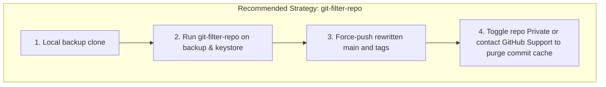

# Alpha X App — P0 Git History Security Investigation Report

**Document Title:** P0 Critical Database Backup Exposure & Git History Investigation  
**Repository Target:** `https://github.com/fitsundar6/alpha_X_app`  
**Investigation Mode:** Strict READ-ONLY Forensic Inspection (Zero Modifying Commands Executed)  
**Timestamp:** 2026-11-04T08:25:00+05:30  
**Current HEAD Commit:** `fe43df3`  

---

## 1. Verified Findings & Empirical Evidence

### Finding 1: Unpurged 4.5 MB Database Backup in Git History
* **File Path in Repository:** `backend/backups/db_backup_2026-10-10T13-01-42-639Z.json`
* **Git Blob Hash:** `b02dff135a6dab78f642b12fe947777b8571f1ad`
* **Exact File Size:** **`4,572,117` bytes** (~4.36 MB / 4.5 MB)
* **Total JSON Lines:** **18,129 lines**
* **First Introduced In:** Commit [`6ec036580f8e1435d0b0d19541a69f4ef486bacc`](https://github.com/fitsundar6/alpha_X_app/commit/6ec036580f8e1435d0b0d19541a69f4ef486bacc) (Date: `Sat Oct 10 19:04:23 2026 +0530`, Commit message: `"final"`)
* **Removed from Working Tree In:** Commit [`23b8a96e70978599fadc10d65c757089376fbe87`](https://github.com/fitsundar6/alpha_X_app/commit/23b8a96e70978599fadc10d65c757089376fbe87) (Date: `Tue Nov 3 18:11:24 2026 +0530`, Commit message: `"fix(security): remove tracked database backup and harden gitignore against dumps"`)
* **Total Commits Containing the Backup File:** **58 commits** in direct ancestry path between `6ec03658` and `23b8a96e`.

### Finding 2: Public Internet Reachability via GitHub Raw
* **Repository Visibility:** **PUBLIC** (`https://github.com/fitsundar6/alpha_X_app` has `private: false`, `forks_count: 0`, `stargazers_count: 0`).
* **Live HTTP Verification:** A bounded read-only HTTP `HEAD` request to:
  `https://raw.githubusercontent.com/fitsundar6/alpha_X_app/6ec036580f8e1435d0b0d19541a69f4ef486bacc/backend/backups/db_backup_2026-10-10T13-01-42-639Z.json`
  returned:
  ```text
  HTTP Status: 200 OK
  Content-Length: 4572117
  Content-Type: text/plain; charset=utf-8
  ```
* **Status:** **CRITICAL ACTIVE EXPOSURE.** Any unauthenticated party on the internet who accesses this URL or clones the repository can download the complete database backup without restriction.

### Finding 3: Actively Tracked Android Keystore in Working Tree & HEAD
* **File Path:** `apps/mobile/android/app/upload-keystore.jks.backup`
* **File Size:** **`2,744` bytes** (Binary Android KeyStore)
* **First Introduced In:** Commit [`947db9042a774bf4a7ed8fafa77492dd78ab344e`](https://github.com/fitsundar6/alpha_X_app/commit/947db9042a774bf4a7ed8fafa77492dd78ab344e) (Date: `Sat Oct 10 18:09:37 2026 +0530`, Commit message: `"finish"`)
* **Current Status:** **ACTIVELY COMMITTED AND PRESENT IN WORKING TREE.** This production/upload release signing keystore was never deleted from the tree and is tracked on `main` at `fe43df3`.

### Finding 4: Local Disk Storage of Uncommitted Backups
* Three additional database backups were identified in the local filesystem under `backend/backups/`:
  1. `db_backup_2026-10-15T13-07-26-664Z.json` (7.15 MB)
  2. `db_backup_2026-10-19T03-15-35-535Z.json` (8.50 MB)
  3. `db_backup_2026-10-27T06-57-13-236Z.json` (13.86 MB)
* **Status:** These three files are properly ignored by `.gitignore` and were **never committed to Git**. They exist solely on local developer disk.

---

## 2. Affected Commit Hashes & Exposure Surface

### Affected Commit Range
* **Initial Exposure Commit:** `6ec036580f8e1435d0b0d19541a69f4ef486bacc`
* **Final Parent Commit Before Working-Tree Removal:** `6e82ef6ec0f3e69557a1b41ba7206410ce420177`
* **Total Affected History Span:** **58 commits**
* **Key intermediate commits holding the file in their tree:**
  `6ec0365`, `df61b10`, `631095e`, `5461070`, `f9b9abd`, `48358dc`, `b4d8076`, `c857254`, `ee8ffb2`, `8b825f3`, `fe3e725`, `72df9d9`, `785ff5c`, `e461fa3`, `f0877af`, `57abc93`, `140d56e`, `3700d1f`, `cf3481f`, `5dce901`, `bb80f86`, `204963d`, `94467d5`, `1638b22`, `ed5d9d9`, `87a37c3`, `5ab37e0`, `85084d1`, `4a39a78`, `eaced58`, `6e82ef6`.

### Branch & Tag Reachability Analysis
* **Current Branch Tips:** The backup file is **ABSENT** from the current tip tree of:
  - `refs/heads/main`
  - `refs/heads/fix/push-notification-production-readiness`
  - `refs/remotes/origin/main`
  - `refs/remotes/origin/fix/gemini-reliability`
* **Historical Ancestry:** Commit `6ec03658` is an **active ancestor of all current branches and tags**. Anyone running `git clone` downloads commit `6ec03658` and the 4.5 MB blob object into their `.git/objects` packfile.
* **Release Tags:** Tags `v1.0.0-build.77` through `v1.0.0-build.89` directly reference commits that have `6ec03658` in their history.

---

## 3. Potential Impact & Breach Scope

The 4.5 MB JSON backup file contains structured exports of production PostgreSQL tables:
1. **User Identity & Credentials (High Exposure):**
   - 36 user records
   - 36 personal email addresses
   - 31 bcrypt password hashes (`passwordHash`)
   - Personal phone numbers
   - Master admin profile references
2. **Device Push Identifiers:**
   - OneSignal push notification device tokens (`oneSignalPlayerId`)
   - Google authentication IDs (`googleUid`)
3. **Sensitive Health & Fitness Telemetry:**
   - 36 detailed client onboarding profiles (height, weight, injury histories, surgery details)
   - Completed workout records, exercise volume, and performance tracking
   - Diet proposals and daily macro targets
   - Meal photo metadata and AI food scanner records
4. **Keystore Exposure:**
   - The commit `947db904` and current working tree file `upload-keystore.jks.backup` exposes the Android app release signing keystore. If the keystore password (`KEYSTORE_PASSWORD` / `KEY_PASSWORD`) is discovered, an attacker could sign malicious APK updates under the same package identifier.

---

## 4. Required Credential Rotations (Names Only)

Based on the exposed backup, git history, and repository configuration, the following credentials must be rotated:

| Credential Name | Storage Location | Exposure Vector | Urgency |
| :--- | :--- | :--- | :--- |
| **Client Passwords (All 36 Accounts)** | Neon PostgreSQL (`users.passwordHash`) | Contained in `db_backup_2026-10-10...json` | **P0 (Immediate)** |
| **`ADMIN_PASSWORD` / Master Admin Password** | Vercel Environment / Mobile Code | Exposed in git history & test files | **P0 (Immediate)** |
| **`JWT_ACCESS_SECRET`** | Vercel Environment Variables | Git history / dev placeholder exposure | **P0 (Immediate)** |
| **`JWT_REFRESH_SECRET`** | Vercel Environment Variables | Git history / dev placeholder exposure | **P0 (Immediate)** |
| **`DATABASE_URL` (Neon PostgreSQL Password)** | Vercel Environment Variables | Historical exposure *(Already rotated in Phase 1)* | **VERIFIED ROTATED** |
| **`GEMINI_API_KEY` (Google Cloud / AI Studio)** | Vercel Environment Variables | Historical exposure *(Already rotated in Phase 1)* | **VERIFIED ROTATED** |
| **`ONESIGNAL_REST_API_KEY`** | Vercel Environment Variables | Historical commit exposure | **P1 (High)** |
| **`CRON_SECRET`** | Vercel Environment Variables | Historical commit exposure | **P1 (High)** |
| **Android Release Signing Keystore & Passwords** | Local tree (`upload-keystore.jks.backup`) | File tracked in Git HEAD | **P1 (High)** |
| **`SMTP_PASS` (Password Reset Email)** | Vercel Environment Variables | Historical commit exposure | **P1 (High)** |

---

## 5. Recommended Cleanup Plan

### Approach Comparison: `git-filter-repo` vs BFG Repo-Cleaner vs Repository Recreation



* **Tool Recommendation:** **`git-filter-repo`** (Official tool recommended by Git documentation; replaces legacy `git filter-branch`).
* **Files to Eradicate from Entire History:**
  1. `backend/backups/db_backup_2026-10-10T13-01-42-639Z.json`
  2. `apps/mobile/android/app/upload-keystore.jks.backup`

### Step-by-Step Execution Plan (Draft — Pending Approval)
1. **Pre-requisite Full Safety Archive:**
   - Create a clean local bare clone backup outside the workspace:
     ```bash
     git clone --mirror https://github.com/fitsundar6/alpha_X_app.git alpha_X_app_ARCHIVE_SAFE.git
     ```
2. **Execute History Filter:**
   - Execute `git-filter-repo`:
     ```bash
     git filter-repo --path backend/backups/db_backup_2026-10-10T13-01-42-639Z.json --invert-paths --force
     git filter-repo --path apps/mobile/android/app/upload-keystore.jks.backup --invert-paths --force
     ```
3. **Verify Elimination:**
   - Confirm blob `b02dff135a6dab78f642b12fe947777b8571f1ad` is absent from all reachable objects.
4. **Force-Push Rewritten History:**
   - Push updated branches and tags to GitHub:
     ```bash
     git remote add origin https://github.com/fitsundar6/alpha_X_app.git
     git push origin --force --all
     git push origin --force --tags
     ```
5. **Neutralize GitHub Commit Cache (Crucial Step):**
   - GitHub retains unreferenced commits in cached views (pull request caches, web commit URLs) for up to 90 days.
   - **Recommended Action:** Temporarily toggle repository visibility to **Private** in GitHub Repository Settings $\rightarrow$ Danger Zone $\rightarrow$ Change visibility $\rightarrow$ Make private. This immediately invalidates the public GitHub cache and terminates `raw.githubusercontent.com` public access.
   - If public access is desired again later, submit a ticket to GitHub Support requesting an immediate cache purge before toggling back to public.

---

## 6. Risks, Precautions, & Collaborator Impact

### Impact on Collaborators & Team Members
* **Commit Hash Changes:** Every commit from `6ec03658` onward will have a new commit hash.
* **Local Clone Divergence:** Any developer who runs `git pull` on an existing local clone will get merge conflicts or re-introduce the old commits.
* **Required Collaborator Action:** All team members must discard existing local clones and run:
  ```bash
  git fetch origin
  git reset --hard origin/main
  # or fresh clone:
  git clone https://github.com/fitsundar6/alpha_X_app.git
  ```

### Impact on Deployments & Services
* **Vercel:** Vercel tracks branch `main`. Force-pushing a rewritten `main` will automatically trigger a new deployment for the latest commit hash without breaking continuous deployment.
* **GitHub Actions:** CI workflows reference branch triggers (`push: branches: [main]`); they will continue to function normally.
* **GitHub Releases:** Existing GitHub Release tags (`v1.0.0-build.89` etc.) will be updated to point to the new rewritten commits.

---

## 7. Exact Next Actions Requiring Approval

To proceed with containment and eradication, the following explicit user approvals are required:

- [ ] **Approval 1 (Pre-flight Backup):** Authorize creating an external offline mirror archive before executing any history modification.
- [ ] **Approval 2 (Git History Rewrite):** Authorize running `git-filter-repo` locally to eliminate `db_backup_2026-10-10T13-01-42-639Z.json` and `upload-keystore.jks.backup` from all commits and tags.
- [ ] **Approval 3 (Force Push to Remote):** Authorize force-pushing rewritten branches and tags to `https://github.com/fitsundar6/alpha_X_app.git`.
- [ ] **Approval 4 (GitHub Visibility Toggle):** Authorize the repository owner to temporarily switch the GitHub repository to **Private** to invalidate GitHub's raw caching layer.
- [ ] **Approval 5 (Credential Rotation Execution):** Authorize executing the credential rotation procedure (forcing client password resets, rotating master admin password, rotating `JWT_ACCESS_SECRET`, `JWT_REFRESH_SECRET`, `CRON_SECRET`, and `ONESIGNAL_REST_API_KEY` in Vercel).

*Awaiting explicit approval before executing any remediation steps.*

